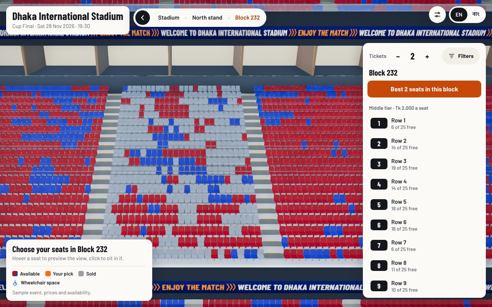
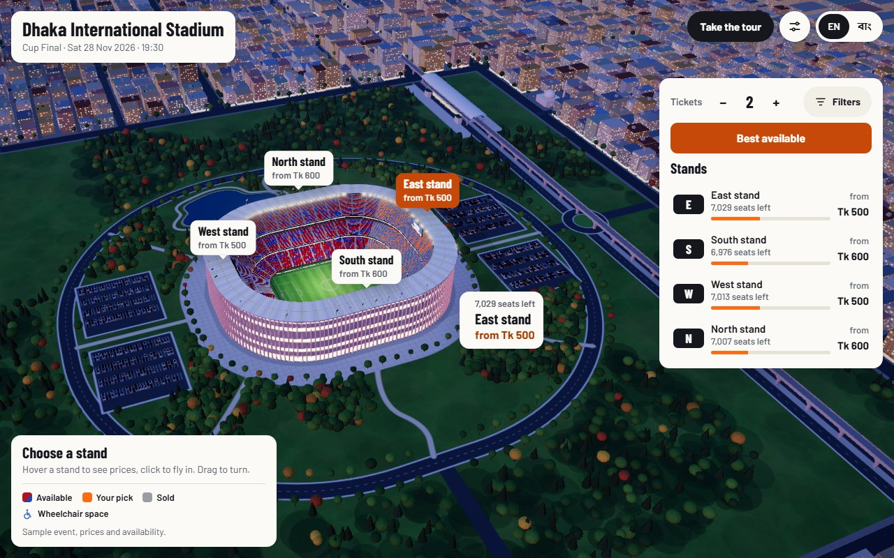

# 3D Stadium Ticketing

A ticket shop for an 80,180-seat football stadium, built around a real-time 3D seat picker. Fly from the whole
stadium to a stand, a block and a seat, see the view from that seat before you buy, and check out, all in the
browser.

https://github.com/user-attachments/assets/955b60ea-7a58-49c9-a253-553c98a0f850

A 25-second walkthrough, with sound (unmute the player): from the stadium to a seat, the view from it with a
live match, day to night, the neighbourhood and MRT Line 6, and tickets in English and Bangla.

**[Live demo: stadium-tickets.vercel.app](https://stadium-tickets.vercel.app)**

> [!NOTE]
> This is a demonstration build for a fictional venue, Dhaka International Stadium. The fixtures (Bangladesh
> home matches against India, Nepal, Bhutan, Pakistan, Sri Lanka and the Maldives), prices and availability
> are sample data, payment uses a demo card, and no email is ever sent. There is no backend: each visitor's
> data stays in their own browser (IndexedDB).

## Contents

- [Features](#features)
- [Screenshots](#screenshots)
- [Getting started](#getting-started)
- [Architecture](#architecture)
- [Testing](#testing)
- [Tech stack](#tech-stack)
- [Limitations](#limitations)
- [Credits](#credits)

## Features

### 3D seat picker

- **80,180 seats:** 79,556 in the bowl and 624 lounge seats in 78 skyboxes, each with a permanent index, drawn
  as instanced meshes with GPU picking for blocks and seats.
- **Camera flights** through four levels (stadium, stand, block, seat), plus skyboxes and VIP lounge chairs. A
  guided tour flies through all of them.
- **Built around the order:** choose how many tickets you need; blocks that can't fit them dim, hovering a
  seat previews the best run of adjacent free seats, and "Best available" ranks every run in the stadium.
- **Filters** for price, wheelchair spaces and restricted views; hover tooltips with live view thumbnails; a
  keyboard path through the seat list; touch sheets on phones.
- **The view from every seat,** rendered on the fly: in the hover thumbnails and on each ticket's page. In a
  seat, the ticket can be hidden to look around, and the view re-frames into the space it frees.

### Match day in 3D

Plain three.js with post-processing:

- **Lighting:** day, blue hour and night match, with smooth transitions, a physical sky with clouds, bloom on
  the floodlights, LED ribbons and lit windows; on the High tier, ambient occlusion and a depth-of-field view
  picture.
- **The crowd:** a spectator in every sold seat (camera-facing sprites from an atlas drawn in code, in the two
  teams' colours, with an away end), low-poly 3D people near the camera on High, idle motion, and a Mexican
  wave that travels round the bowl (the home page's crowd starts one now and then).
- **A live match** whenever the crowd is in: 22 players in the teams' colours, the referee, two assistants and
  the ball, playing a simple simulation (shape, passing, pressing, tackles, shots and saves, throw-ins, corners
  and goal kicks). A goal sends the scorer to the corner flag, the scoring side's fans jump, and the big
  screens and ribbons flash "GOAL!".
- **The neighbourhood:** about 9,500 procedural blocks of flats in Dhaka's facade colours, with lanes, shops
  along the main roads, stair rooms and water tanks on the roofs, eleven mosques and street lights; windows
  light up at dusk. MRT Line 6 runs past on its viaduct, with Mirpur 10 station and trains that stop and pull
  away.
- **Detail:** scrolling LED boards with a live kick-off countdown, a procedural pitch with crisp markings, goal
  nets, waving flags, roof cables, swaying trees and drifting cloud shadows.
- **Performance:** Low, Medium and High quality tiers, chosen automatically from measured frame times; the
  renderer sleeps when nothing moves. Without WebGL the picker falls back to a 2D plan, and the whole purchase
  still works.

### Buying tickets

- **Holds:** seats are held for 10 minutes. Holds and sales change seats inside IndexedDB transactions and are
  broadcast to every open tab, so two tabs behave like two visitors and can't take the same seat.
- **Live availability:** simulated buyers hold and buy seats while an event page is open.
- **Demo checkout:** a card form with Luhn, expiry and security-code checks; only the card brand and the last
  four digits are kept.
- **Tickets that look like match tickets:** a notched paper ticket that tilts towards the pointer, with both
  teams' flags, the venue, the date and times, the seat and a perforated stub with a QR code once paid. Tickets
  download as a PDF and a calendar file, both made in the browser, and the confirmation email goes to a local
  outbox that can be previewed.

### The site

- Home page with the 3D stadium as its hero, events with filters, venue information with a gates plan,
  questions, sample legal pages and Open Graph images. Each match shows both teams' flags.
- English and Bengali throughout, with dates in Dhaka time and prices in taka (Tk in English, ৳ in Bengali).
- Accessible: keyboard navigation, screen-reader labels, AA contrast, and reduced motion respected.
- Re-brandable: the venue's name, colours, currency, prices, hold time and fees live in one file,
  [`src/config/brand.ts`](src/config/brand.ts).

## Screenshots


| Home page                                                                                  | Choosing seats in a block                                |
| ------------------------------------------------------------------------------------------ | -------------------------------------------------------- |
|  |  |

| Blue hour over the neighbourhood                                                                           | Night match                                |
| ---------------------------------------------------------------------------------------------------------- | ------------------------------------------ |
|  |  |

## Getting started

Requirements: Node.js 22.12 or newer. No accounts or keys are needed; the sample events are created in your
browser on the first visit.

```bash
git clone https://github.com/SHAYAN-ABRAR/3D-Stadium-Ticketing.git
cd 3D-Stadium-Ticketing
npm install
npm run dev        # http://localhost:3000
```

| Command                          | What it does                                                                    |
| -------------------------------- | ------------------------------------------------------------------------------- |
| `npm run dev`                    | Development server on port 3000                                                 |
| `npm run build`, `npm start`     | Production build and server                                                     |
| `npm run typecheck`              | Route types and TypeScript                                                      |
| `npm run lint`, `npm run format` | ESLint and Prettier                                                             |
| `npm test`                       | Unit tests (Vitest): layout, data store, cards, tickets, engine logic, messages |
| `npm run test:e2e`               | End-to-end tests (Playwright, Chromium)                                         |

Useful address parameters on an event page:

| Parameter                    | Effect                                        |
| ---------------------------- | --------------------------------------------- |
| `?quality=low\|medium\|high` | Fixes the quality tier instead of choosing it |
| `?debug=1`                   | Frame time, draw calls and triangles          |
| `?webgl=0`                   | The 2D fallback                               |
| `?freeze=1`                  | No ambient animation                          |

Optional environment variable: `NEXT_PUBLIC_SITE_URL`, the public address used in metadata (on Vercel the
production domain is used automatically).

## Architecture

| Layer          | Where                         | Notes                                                                                                                           |
| -------------- | ----------------------------- | ------------------------------------------------------------------------------------------------------------------------------- |
| Stadium layout | `src/lib/stadium/`            | Pure TypeScript: every seat's position, index, label and price. Shared by everything.                                           |
| 3D engine      | `src/engine/`                 | Plain three.js (no React): scene, camera rig, picking, crowd, lighting, post-processing, snapshots. Loaded only in the browser. |
| Data           | `src/data/`                   | A `DataStore` interface implemented on Dexie (IndexedDB): events, seats, holds, orders, tickets, outbox.                        |
| UI             | `src/components/`, `src/app/` | Next.js App Router, React 19, Tailwind CSS 4, Radix UI, next-intl.                                                              |

```text
src/
  app/          Routes: home, events, the event's seat picker, checkout, orders, tickets, venue, FAQ, legal
  components/   UI: picker, home, events, checkout, order, ticket, site
  config/       brand.ts: the venue, its commercial rules and colours
  data/         The DataStore on Dexie (IndexedDB) and the simulated buyers
  engine/       The 3D engine: scene and world, camera, picking, crowd, match, lighting, post-processing
  i18n/         Locale configuration (next-intl)
  lib/          Stadium layout, seat runs and selection, tickets (codes, PDF, calendar), email, formatting
messages/       English and Bengali messages
tests/          Unit tests (Vitest)
e2e/            End-to-end tests (Playwright)
docs/           Architecture notes, decision log, screenshots
```

More detail: [docs/ARCHITECTURE.md](docs/ARCHITECTURE.md) and the decision log
[docs/DECISIONS.md](docs/DECISIONS.md).

## Testing

- **Unit tests** cover the seat layout (exact parity with the original prototype), the data store (including 25
  tabs racing for the same seats, expiry and checkout), card checks, tickets (codes, QR, PDF, calendar file,
  email) and the engine's pure logic.
- **End-to-end tests** drive the real 3D view in headless Chromium with software WebGL: every navigation level,
  mouse, keyboard and touch flows, two tabs competing for seats, full purchases in 3D and in the 2D plan,
  lighting presets, the crowd and the wave, and the site pages. They wait on the engine's state, never on fixed
  sleeps.

## Tech stack

- **App:** Next.js 16 (App Router), React 19, TypeScript 6, Tailwind CSS 4, Radix UI, next-intl 4, Zustand
- **3D:** three.js r187 with postprocessing and N8AO
- **Data:** Dexie 4 on IndexedDB
- **Tickets:** pdf-lib, qrcode, react-parallax-tilt
- **Tests:** Vitest 5, Playwright

## Limitations

- It's a demo: the stadium, the fixtures and the prices are fictional, payments are simulated and no email is
  sent.
- Data lives in the browser that created it: orders and tickets can't be opened in another browser, and
  clearing the site's data deletes them.

## Credits

The flags are from [flag-icons](https://github.com/lipis/flag-icons) (MIT licence, in `public/flags/`).
