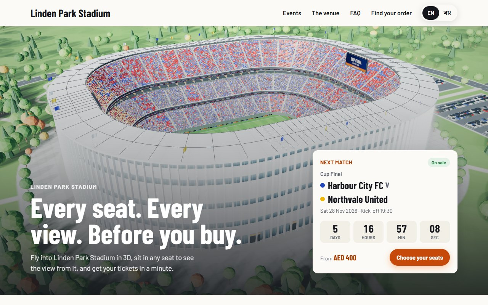
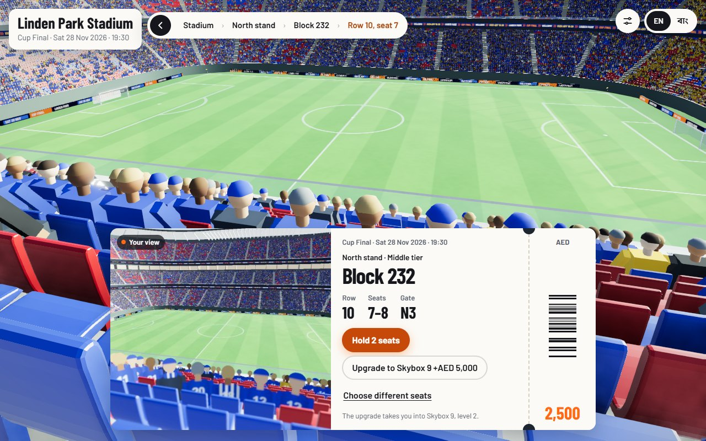
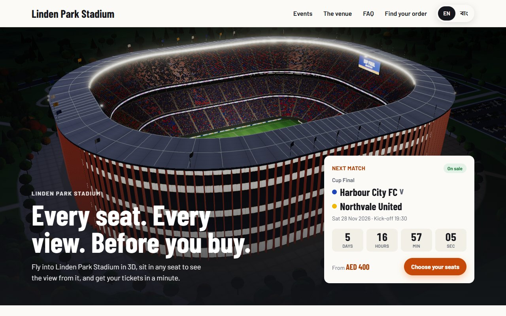

# Linden Park Stadium: tickets with a 3D seat picker

A ticket shop for a fictional 80,000-seat football stadium, built around a real-time 3D seat picker. Fly from
the whole stadium to a stand, a block and a row, sit in any seat to see the view from it, and buy tickets with
a demo card. The site runs entirely in the browser: there is no backend, every visitor's data lives in their
own browser (IndexedDB), the checkout is a demo and no email is ever sent.



## What it does

**The 3D seat picker**

- 80,180 seats (79,556 in the bowl, 624 lounge seats in 78 skyboxes), each with a permanent index, drawn as
  instanced meshes; GPU picking for blocks and seats.
- Four levels with camera flights: stadium, stand, block, seat, then skyboxes and VIP lounge chairs.
- Choose how many tickets you need: blocks that can't fit them dim, hovering a seat previews the best run of
  adjacent free seats, and "Best available" ranks every run in the stadium.
- Filters for price, wheelchair spaces and restricted views; hover tooltips with live view thumbnails; a
  keyboard path through the seat list; touch sheets on phones.
- A "Your view" picture of every seat, rendered on the fly and printed on the ticket.

**Graphics and animation** (three.js with post-processing)

- Golden hour, day and night match lighting with smooth transitions, a physical sky with clouds, bloom on
  floodlights, LED ribbons and lit windows, and on the High tier ambient occlusion plus a depth-of-field
  "Your view" picture.
- A match-day crowd: a spectator in every sold seat (camera-facing sprites from an atlas drawn in code, in
  the two teams' colours, with an away end), low-poly 3D people near the camera on the High tier, idle
  motion, and a Mexican wave that travels round the bowl (the home page's crowd starts one now and then).
- Scrolling LED boards with a live kick-off countdown, a procedural pitch with crisp markings, goal nets,
  waving flags, roof cables, swaying trees and drifting cloud shadows.
- Low, Medium and High quality tiers, chosen automatically from measured frame times; the renderer sleeps
  when nothing moves. Without WebGL the picker falls back to a 2D plan, and the whole purchase still works.

**Buying tickets**

- Seats are held for 10 minutes. Holds and sales change seats inside IndexedDB transactions and are
  broadcast to every open tab, so two tabs behave like two visitors (and can't take the same seat).
- Simulated buyers hold and buy seats while an event page is open, so availability changes live.
- A demo card form (Luhn, expiry and security-code checks; only the brand and last four digits are kept).
- The confirmation prints a ticket with a QR code; tickets download as a PDF and a calendar file, both made
  in the browser. The confirmation email goes to a local outbox and can be previewed.

**The site**

- Home page with the 3D stadium as its hero, events with filters, venue information with a gates plan,
  questions, sample legal pages, Open Graph images.
- English and Bengali throughout, dates and prices in the venue's time zone and currency.
- Accessible: keyboard navigation, screen-reader labels, AA contrast, reduced motion respected.






## Running it

Requirements: Node.js 22.12 or newer.

```bash
npm install
npm run dev        # http://localhost:3000
```

No accounts or keys are needed. The sample events are created in your browser on the first visit.

| Command                          | What it does                                                                    |
| -------------------------------- | ------------------------------------------------------------------------------- |
| `npm run dev`                    | Development server on port 3000                                                 |
| `npm run build`, `npm start`     | Production build and server                                                     |
| `npm run typecheck`              | Route types and TypeScript                                                      |
| `npm run lint`, `npm run format` | ESLint and Prettier                                                             |
| `npm test`                       | Unit tests (Vitest): layout, data store, cards, tickets, engine logic, messages |
| `npm run test:e2e`               | End-to-end tests (Playwright, Chromium)                                         |

Useful address parameters on an event page: `?quality=low|medium|high`, `?debug=1` (frame time, draw calls,
triangles), `?webgl=0` (the 2D fallback), `?freeze=1` (no ambient animation).

Optional environment variable: `NEXT_PUBLIC_SITE_URL`, the public address used in metadata (on Vercel the
production domain is used automatically).

## How it's built

| Layer          | Where                         | Notes                                                                                                                           |
| -------------- | ----------------------------- | ------------------------------------------------------------------------------------------------------------------------------- |
| Stadium layout | `src/lib/stadium/`            | Pure TypeScript: every seat's position, index, label and price. Shared by everything.                                           |
| 3D engine      | `src/engine/`                 | Plain three.js (no React): scene, camera rig, picking, crowd, lighting, post-processing, snapshots. Loaded only in the browser. |
| Data           | `src/data/`                   | A `DataStore` interface implemented on Dexie (IndexedDB): events, seats, holds, orders, tickets, outbox.                        |
| UI             | `src/components/`, `src/app/` | Next.js App Router, React 19, Tailwind CSS 4, Radix UI, next-intl.                                                              |

Stack: Next.js 16, React 19, TypeScript 6, three.js r187 with postprocessing and N8AO, Dexie 4, Tailwind
CSS 4, next-intl 4, pdf-lib, qrcode, Vitest 5, Playwright.

More detail: [docs/ARCHITECTURE.md](docs/ARCHITECTURE.md) and the decision log
[docs/DECISIONS.md](docs/DECISIONS.md).

## Testing

- Unit tests cover the seat layout (exact parity with the original prototype), the data store (including 25
  tabs racing for the same seats, expiry and checkout), card checks, tickets (codes, QR, PDF, calendar file,
  email) and the engine's pure logic.
- End-to-end tests drive the real 3D view in headless Chromium with software WebGL: every navigation level,
  mouse, keyboard and touch flows, two tabs competing for seats, full purchases in 3D and in the 2D plan,
  lighting presets, the crowd and the wave, and the site pages. They wait on the engine's state, never on
  fixed sleeps.

## Limitations

- It's a demo: the teams, matches and prices are fictional, payments are simulated and no email is sent.
- Data lives in the browser that created it: orders and tickets can't be opened in another browser, and
  clearing the site's data deletes them.
